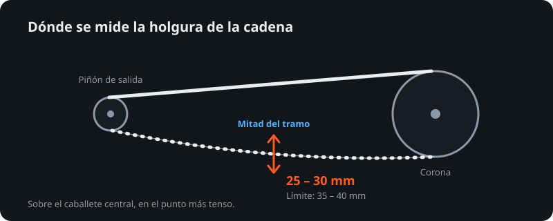

> El manual da dos juegos de valores. El punto de mantenimiento periódico indica 25 – 30 mm de holgura estándar y 35 – 40 mm de límite; la tabla de límites de servicio del chasis indica 15 – 25 mm de estándar y 30 – 40 mm de límite. Esta guía usa los del procedimiento de ajuste. Con cualquiera de los dos, una cadena que llega a 35 – 40 mm necesita ajuste.

## Medición

1. Apoya la moto sobre el caballete central.
2. Gira la rueda trasera hasta encontrar el punto en que la cadena queda más tensa.
3. Mide el movimiento vertical de la cadena a mitad del tramo entre el piñón de salida y la corona.
4. Si la cadena está demasiado floja o demasiado tensa, ajústala al valor estándar.

## Ajuste

1. Afloja la tuerca del eje trasero.
2. Gira los reguladores de los dos lados hasta dejar la holgura en el valor estándar, con ambos tensores en la misma marca.
3. Comprueba otra vez que la holgura esté dentro del valor especificado.
4. Aprieta la tuerca del eje trasero a 8.0 – 10.0 kgf·m.

## Desgaste

1. Con la cadena tensa, mide el largo de 20 eslabones. Si supera los 307 mm, cambia la cadena.
2. Revisa la corona: su deformación no debe pasar de 0.5 mm.

> La tabla de límites del manual rotula la medida de la cadena como «20 eslabones» y anota «19 link» junto al valor estándar; el dibujo mide del 1.er al 20.º pasador.
