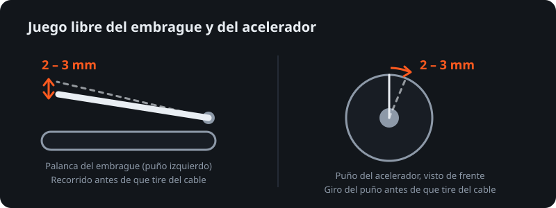

## En el manubrio

1. Gira el tensor del cable hasta dejar 2 a 3 mm de juego libre en el puño.
2. Aprieta la tuerca del tensor.

## Junto al carburador

Usa este ajuste solo si el tensor del manubrio no alcanza.

1. Ubica el tensor del extremo del cable, en el soporte que está junto al carburador.
2. Afloja las dos tuercas del soporte del cable.
3. Ajusta el juego con el tensor hasta obtener 2 a 3 mm en el puño.
4. Aprieta las dos tuercas una contra la otra, sosteniendo una y girando la otra.
5. Comprueba de nuevo el juego en el puño.

> El cuadro de mantenimiento pide revisar el juego del acelerador, el ralentí (1500 ± 100 rpm) y el ajuste del TPS en cada servicio. El manual no describe cómo ajustar el ralentí ni el TPS.
