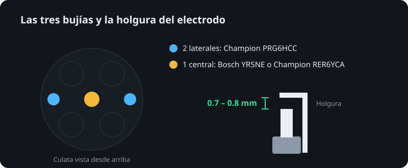

El motor lleva una bujía central, alimentada por la bobina central, y dos laterales (izquierda y derecha), alimentadas por la bobina doble. La llave 3 en 1 permite sacar las tres con el motor montado en la moto.

## Desmontaje

1. Retira el capuchón de la bujía lateral izquierda y el de la bujía central, que queda en la parte de arriba de la culata.
2. En el lado derecho, retira la tapa que cubre la bujía y luego su capuchón.
3. Afloja y retira la bujía lateral izquierda con la llave 3 en 1.
4. Con la lateral izquierda ya afuera, retira la bujía central con la misma llave.
5. Retira la bujía lateral derecha.

## Revisión y montaje

1. Limpia cada bujía con un limpiador de bujías.
2. Mide la holgura del electrodo: debe estar entre 0.7 y 0.8 mm. Ajústala si hace falta.
3. Si alcanzaron los 20 000 km, reemplázalas por el tipo indicado para cada posición: no son iguales la central y las laterales.
4. Coloca las bujías y apriétalas a 1.3 – 1.5 kgf·m.
5. Vuelve a montar los capuchones y la tapa del lado derecho en su posición original.

> El cuadro de mantenimiento pide limpiar y ajustar la holgura en cada servicio y cambiar las tres bujías en el servicio de los 20 000 km. La página de mantenimiento periódico solo nombra la Bosch YR5NE para la posición central; la sección eléctrica agrega la Champion RER6YCA como alternativa.
