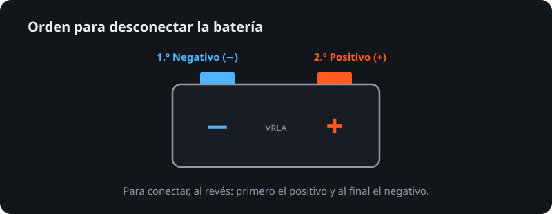

## Desconexión

1. Apaga el encendido y quita el asiento delantero.
2. Retira las 2 tapas de PVC de los terminales de la batería.
3. Afloja y desconecta el terminal negativo.

   
4. Desconecta el terminal positivo.
5. Retira la batería.

## Instalación

1. Coloca la batería en su soporte.
2. Conecta primero el terminal positivo y al final el negativo.
3. Protege los bornes con vaselina y coloca las 2 tapas de PVC.
4. Monta el asiento y vuelve a poner la hora en el tablero: se pierde al desconectar la batería.

> El manual no es uniforme con la herramienta: en el desmontaje pide una llave de 10 mm, y en los cuidados de la batería pide un destornillador de estrella o una llave en T y prohíbe la llave de boca. Usa una llave en T o de copa, que no se resbala.

> Tampoco lo es con la protección de los bornes: los cuidados de la batería piden vaselina y prohíben la grasa, mientras que el procedimiento de carga pide grasa dieléctrica. No uses grasa común.
