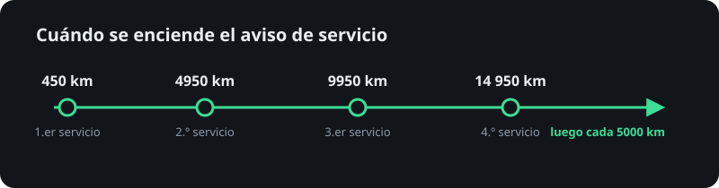

El tablero avisa con el símbolo de la llave cuando el odómetro llega al kilometraje de servicio. El aviso sigue apareciendo hasta que se reinicia, lo que se hace al completar el servicio. Qué se revisa en cada servicio está en la tabla «Programa de mantenimiento periódico» de la ficha de la moto.

## Botones

- **Modo:** cambia entre Trip 1, Trip 2, reloj e indicador de servicio.
- **Set:** ajusta o reinicia la función que está en pantalla.

## Otros avisos del tablero

- **Temperatura del refrigerante:** parpadea cuando supera los 115 °C. Detén la moto.
- **Presión de aceite:** parpadea cuando la presión de aceite del motor es baja.
- **Batería:** indica que la batería necesita carga.
- **Gato lateral:** se enciende cuando el gato lateral está abajo.
- **Neutro:** se enciende con la caja en neutro y el encendido conectado.
- **Reserva:** queda encendido cuando el combustible llega al nivel de reserva. El mismo testigo funciona como aviso de revoluciones del motor.

> El manual dice que el testigo de reserva parpadea cuando el motor llega a «la marca de 1000 rpm». Ese valor está por debajo del ralentí (1500 rpm), así que parece una errata; el manual no da otro dato.
