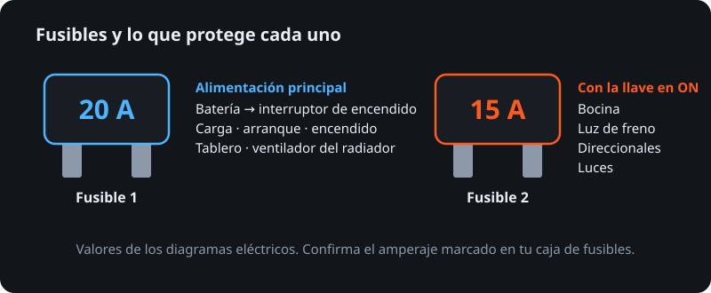

1. Apaga el encendido y quita el asiento delantero: la caja de fusibles está junto a la batería.

   
2. Retira cada fusible e inspecciónalo a la vista: el filamento debe estar entero.
3. Comprueba la continuidad de cada fusible con el multímetro.
4. Reemplaza los que estén quemados por fusibles del amperaje correcto.

> Un fusible de menor amperaje se quemará constantemente. Si el fusible correcto se vuelve a quemar, el problema no es el fusible: hay que diagnosticar la falla en el circuito.

> Los diagramas eléctricos del manual indican 20 A para el fusible 1 y 15 A para el fusible 2, pero la foto de la página de inspección muestra un fusible de 10 A junto a uno de 15 A. Confirma el amperaje marcado en la caja de fusibles de tu moto antes de comprar repuestos.
