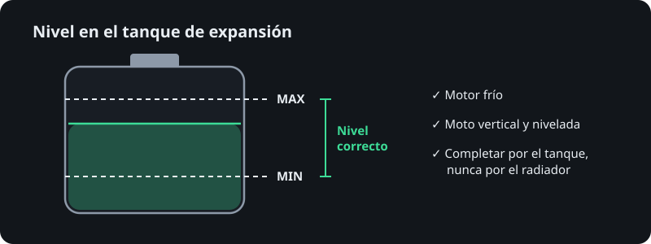

1. Espera a que el motor esté frío.
2. Apoya la moto sobre el caballete central. Con el gato lateral la lectura es incorrecta.
3. Mira el nivel en el tanque de expansión: debe estar entre las marcas MIN y MAX.

   
4. Si falta, quita la tapa del tanque de expansión y agrega refrigerante hasta la marca MAX. No completes por la tapa del radiador.
5. Coloca la tapa del tanque de expansión.

> Si necesitas agregar 200 ml o más, el sistema tiene aire y hay que purgarlo: sigue la guía de cambio de refrigerante. Si el nivel baja seguido, revisa fugas y la tapa del radiador.

> Dos diferencias dentro del manual: el punto de mantenimiento acepta el nivel entre MIN y MAX, mientras que la carta de refrigeración pide tenerlo en la marca MAX; y la descripción del sistema recomienda una mezcla de 50 % de etilenglicol y 50 % de agua, mientras que la carta habla de refrigerante «diluido al 33 %». Completa siempre con el mismo producto que ya tiene el sistema.
