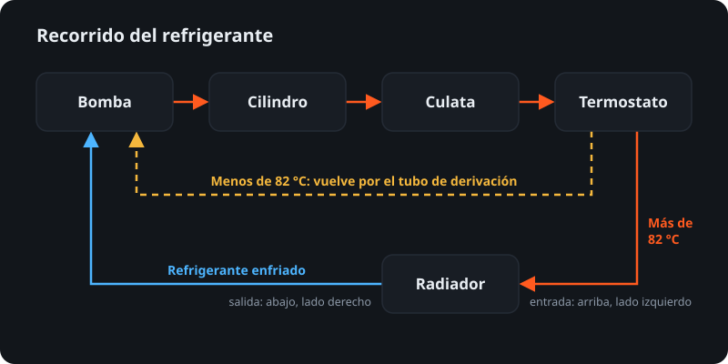

## Cómo circula el refrigerante

La bomba impulsa el refrigerante por los conductos del cilindro y de la culata hasta el termostato. Con el motor frío (menos de 82 °C) el termostato lo devuelve a la bomba por el tubo de derivación para que el motor caliente rápido. Al superar esa temperatura, lo envía a la parte superior izquierda del radiador; sale enfriado por la parte inferior derecha y vuelve a la bomba.

Cuando el refrigerante se dilata, la válvula de presión de la tapa del radiador abre a 1.4 kg/cm² y lo deja pasar al tanque de expansión. Al enfriarse el motor se forma vacío y la otra válvula de la tapa lo deja volver al radiador.

## Para evitar que se mezclen aceite y refrigerante

- Reemplaza siempre la junta de culata y la junta del cilindro por nuevas al abrir el motor.
- Reemplaza la junta gris de los cárteres cada vez que los separes.
- Reemplaza los sellos de la bomba de refrigerante cada vez que separes los cárteres.

## Mangueras y abrazaderas

- Coloca cada abrazadera en la marca blanca de la manguera, a 3 mm del extremo.
- Usa abrazaderas nuevas al montar: una reutilizada puede agrietarse y dejar fugas.
- El cuadro de mantenimiento pide revisar mangueras y abrazaderas desde el 2.º servicio y cambiar las mangueras cada 35 000 km o 3 años.
