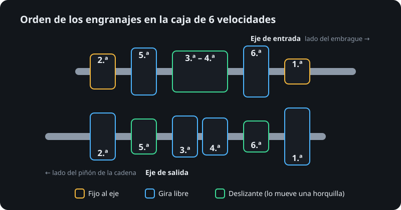

El manual desarma el motor en este orden: primero la culata, el cilindro y el pistón; después la tapa del embrague y el embrague; y por último lo que cubre esta guía. Empieza por las guías «Desmontar la culata, el cilindro y el pistón» y «Desmontar y revisar el embrague».

## Mecanismo de cambios

1. Retira el eje de cambios.
2. Quita el perno del tope del tambor y retira la arandela de diámetro grande, el brazo de tope, su buje y el resorte.
3. Quita el perno de la guía selectora (estrella) y retira la guía y su espaciador.

## Bomba de aceite y cadenilla

1. Quita el anillo de seguridad y retira el engranaje de la bomba de aceite.
2. Quita los 3 tornillos M6 × 30 (cabeza de 8 mm) y retira el cuerpo de la bomba con sus 2 pasadores guía.
3. Retira el rotor interno y el rotor externo.
4. Quita los pernos de la guía de la cadenilla y retira la guía y la cadenilla de distribución.

## Tapa del volante y rotor

1. Quita los 9 pernos M6 × 30 de la tapa del volante (cabeza de 8 mm), aflojándolos en cruz, y retira la tapa.
2. Sujeta el rotor con el soporte especial y quita su perno hexagonal (14 mm) y la arandela.
3. Saca el rotor con el extractor y recupera su chaveta.
4. Retira los engranajes 1 y 2 del motor de arranque.

## Balanceador

1. Sujeta los engranajes con la herramienta especial y quita la tuerca del piñón del balanceador.
2. Retira la arandela Belleville (cónica), el engranaje del balanceador y su chaveta.
3. Quita el perno hexagonal del piñón conducido y retira la arandela especial y el piñón.

## Interruptor de neutro y estator

1. Quita los 2 pernos M5 × 10 y el soporte superior del arnés.
2. Quita el perno M5 × 10 y el soporte inferior del arnés.
3. Quita los 2 pernos M5 × 16 y retira el interruptor de neutro.
4. En la tapa del volante, quita los 2 pernos M5 × 13 y retira la bobina pulsora.
5. Quita el perno M5 × 6 y la lámina de fijación del cableado.
6. Quita los 3 pernos Allen del estator (llave de 4 mm) y retíralo.

## Bomba de agua

1. Quita los 5 pernos M6 × 20 (cabeza de 8 mm) y retira la cubierta de la bomba con su O-ring.
2. Quita la tuerca ciega y la arandela.
3. Retira el rotor de la bomba de agua.

## Separación de los cárteres

1. Quita los 4 pernos largos M6 × 60.
2. Quita los 10 pernos cortos M6 × 45 del lado del volante.
3. Separa los cárteres con el separador especial.
4. Retira la mitad del cárter, la junta y los 2 pasadores guía (diámetro 14).
5. Retira el cigüeñal.

## Caja de cambios

1. Retira los ejes de las horquillas de entrada y de salida con sus 2 resortes.
2. Retira el tambor selector.
3. Retira las horquillas de cambio de entrada y de salida.
4. Retira juntos el eje de entrada y el eje de salida. No pierdas la arandela del engranaje de 1.ª del eje de salida ni la que va bajo el engranaje de 2.ª del eje de entrada.

## Orden de las piezas de los ejes

El despiece del manual muestra este orden. Entre los engranajes van arandelas y anillos de seguridad; márcalos al sacarlos y móntalos en el mismo lugar.

- **Eje de entrada**, desde el extremo opuesto al embrague: arandela de 0.5 mm, engranaje de 2.ª, engranaje de 5.ª, engranaje doble de 3.ª y 4.ª, anillo de seguridad y arandela, buje y engranaje de 6.ª, y otra arandela. El engranaje de 1.ª forma parte del eje.
- **Eje de salida**, desde el lado del piñón de la cadena: anillo de seguridad y arandela, engranaje conducido de 2.ª con su buje, conducido de 5.ª, arandela, conducido de 3.ª, arandela de seguridad, conducido de 4.ª, anillo de seguridad externo, conducido de 6.ª, buje y conducido de 1.ª, y arandela de 0.8 mm.

En el eje de entrada, los engranajes de 1.ª y 2.ª son fijos, los de 5.ª y 6.ª giran libres y el doble de 3.ª y 4.ª se desliza. En el eje de salida se deslizan los conducidos de 5.ª y 6.ª y giran libres los de 1.ª, 2.ª, 3.ª y 4.ª.

## Consejos para el armado

- El eje balanceador se monta desde el lado del embrague; comprueba que asiente bien.
- Alinea las marcas grabadas del balanceador y de su engranaje: deben quedar enfrentadas (180°).
- Calienta el cárter antes de montar el cigüeñal.
- Usa paños que no suelten pelusa y una bandeja plástica para no dañar las piezas.
- Reemplaza todas las juntas, sellos y retenes. Los sellos de la bomba de refrigerante y la junta gris de los cárteres se cambian cada vez que se separan los cárteres.
- Deja 0.5 – 0.7 mm entre la bobina pulsora y el rotor.
- Tras desarmar el motor, la carga de aceite es de 1400 ml.
