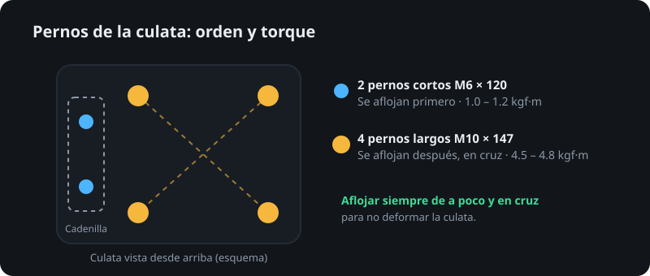

El manual describe este desarme con el motor ya fuera del chasis, como primera parte del desarme completo.

## Tapa de culata y punto muerto superior

1. Quita los 4 pernos de la tapa de culata (cabeza de 6 mm), aflojándolos en cruz, y retira la tapa con su junta de goma moldeada.
2. Gira el motor hasta el punto muerto superior: la marca del volante debe quedar alineada en la ventana del cárter y las marcas del piñón de distribución, paralelas al borde de la culata.

## Tensor y piñón de distribución

1. En el tensor de la cadenilla, quita el perno central (6 mm) y su empaque.
2. Gira el tornillo interno del tensor en sentido horario para recogerlo.
3. Quita los 2 pernos M6 de fijación (cabeza de 8 mm) y retira el tensor y su junta.
4. Sostén el piñón de distribución con la herramienta especial 37 1030 54.
5. Quita el perno especial del piñón (12 mm), el piñón y el espaciador del árbol de levas.

## Culata

1. Retira la bujía derecha.
2. Quita el tornillo de seguridad y saca el buje de la bujía derecha. Antes de tirar, gíralo envuelto en un paño de algodón suave.
3. Afloja primero los 2 pernos cortos M6 × 120 (cabeza de 8 mm).
4. Afloja en cruz los 4 pernos largos M10 × 147 (cabeza de 12 mm).
5. Retira la culata completa.

## Árbol de levas y válvulas

1. Retira los 2 pasadores (ejes) de los balancines y los 2 balancines.
2. Quita el anillo de seguridad y saca el árbol de levas.
3. Comprime cada resorte con el compresor de resortes de válvula y retira las cuñas.
4. Retira los 4 platillos superiores, los 4 resortes, los 4 retenedores y el asiento de cada resorte.
5. Saca las 2 válvulas de admisión y las 2 de escape. Guárdalas ordenadas para devolver cada una a su lugar.

## Cilindro y pistón

1. Retira la junta de culata, la guía de la cadenilla y los 2 pasadores guía.
2. Levanta el bloque del cilindro.
3. Tapa la boca del cárter con un paño sin pelusa para que no caiga nada adentro.
4. Quita el anillo de seguridad del pasador del pistón, empuja el pasador con el botador y retira el pistón.
5. Retira la junta del cilindro y sus 2 pasadores guía.

## Revisión y armado

1. Mide las piezas y compáralas con la tabla. Reemplaza lo que supere el límite de servicio.
2. Arma en orden inverso con juntas nuevas.
3. Aprieta los pernos de culata largos en cruz a 4.5 – 4.8 kgf·m y los cortos a 1.0 – 1.2 kgf·m.
4. Monta el piñón de distribución con las marcas alineadas y aprieta su perno a 2.5 kgf·m.
5. Monta el tensor (pernos a 1.0 – 1.2 kgf·m) y la tapa de culata (1.0 – 1.2 kgf·m).
6. Ajusta la holgura de válvulas siguiendo su guía.

> La junta del cilindro es la de color gris. Cambiarla junto con la junta de culata en cada desarme es una de las precauciones del manual para que no se mezclen el aceite y el refrigerante.
