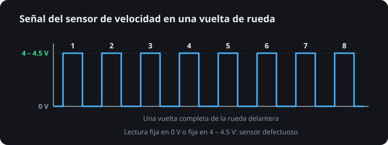

1. Levanta la rueda delantera para que gire libre.
2. Pon el multímetro en la escala de 20 V DC.
3. Sin desconectar el sensor, pincha por detrás su conector de 4 vías: punta positiva en el cable azul/blanco (señal) y punta negativa en el cable negro/amarillo (masa).
4. Pon el encendido en ON.
5. Haz una marca en la llanta para saber cuándo completa una vuelta.
6. Gira la rueda despacio una vuelta completa mirando el multímetro.

   
7. La lectura debe pasar 8 veces de 0 V a 4 – 4.5 V. Si se queda fija en cualquiera de los dos valores, el sensor está defectuoso.

## Antes de cambiar el sensor

1. Comprueba que el cable del sensor esté entero y no roce con otra pieza.
2. Comprueba que la distancia entre el sensor y el anillo magnético esté entre 0.5 y 4 mm.
3. Revisa que el anillo de sello (O-ring) del sensor esté entero. Si lo cambias, usa uno de la medida correcta.
4. Si la lectura se queda en 0 V, comprueba que al sensor le llegue alimentación por el cable rojo/blanco, que viene del tablero.

> El manual no indica el voltaje de alimentación del cable rojo/blanco; el diagrama solo muestra que sale del pin 2 del tablero y que la señal vuelve al pin 12 por el cable azul/blanco.
