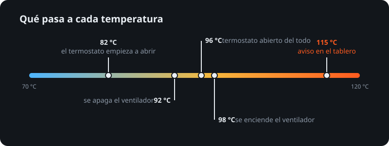

## Termostato

1. Retira el termostato y sumérgelo en agua o aceite junto con un termómetro.
2. Calienta de a poco y observa la válvula.
3. Debe empezar a abrir a los 82 °C y quedar totalmente abierta a los 96 °C. Si no lo hace, reemplázalo.

> El manual se contradice: la descripción del sistema y la página de control indican 82 °C para el inicio de apertura, y la carta de refrigeración indica 88 ± 2 °C. Ante la duda, usa el valor grabado en el propio termostato.

## Sensor de temperatura del refrigerante

1. Desconecta el conector del sensor.
2. Con el multímetro en la escala de 20 kΩ, mide entre los pines 1 y 2.
3. Compara la lectura con la tabla según la temperatura del sensor.
4. Si cambias el sensor, apriétalo a 1.2 – 1.4 kgf·m.

El cable negro/blanco del sensor recibe 4.6 V con el conector suelto; al conectarlo, el voltaje baja a unos 2.4 V por la resistencia del sensor.

El CDI usa esta señal para activar el relé del ventilador cuando el refrigerante supera los 98 °C y para encender el aviso del tablero a los 115 °C.
