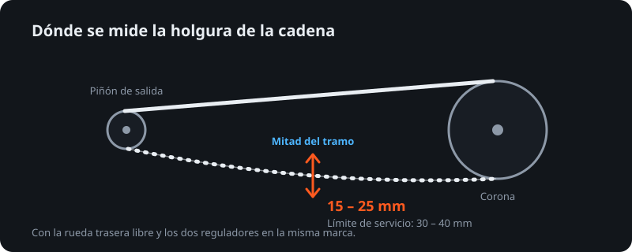

## Medición

1. Apoya la moto firme en un soporte de taller, con la rueda trasera libre.
2. Gira la rueda trasera y mide el movimiento vertical de la cadena a mitad del tramo inferior.
3. Si no está entre 15 y 25 mm, ajústala.

## Ajuste

1. Afloja la tuerca del eje trasero.
2. Gira los reguladores izquierdo y derecho hasta dejar la holgura entre 15 y 25 mm, con ambos en la misma marca.
3. Aprieta la tuerca del eje trasero.
4. Comprueba otra vez la holgura.

## Desgaste

1. Mide la longitud de la cadena entre los pasadores que indica la tabla: de 301.6 a 302.1 mm es estándar. Si llega a 307.0 mm, cambia la cadena.
2. Revisa la corona: su deformación no debe pasar de 0.5 mm.

> Torque de la tuerca del eje trasero: la página de torques del chasis indica 10.0 – 12.0 kg·m y la lista de pre-entrega, 10 kg·m. La página del procedimiento de ajuste no trae los valores de holgura (remite a «especificaciones del chasis»); los de esta guía son los de la tabla de datos del chasis, que coinciden con la lista de pre-entrega y la página de puesta a punto.

> La tabla rotula la medida de la cadena como «longitud de 19 eslabones» y el dibujo cuenta del 1.er al 19.º pasador.
