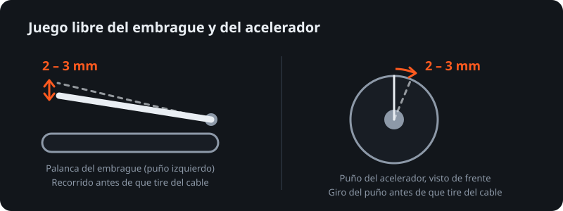

1. Gira el puño del acelerador despacio y mide cuánto se mueve antes de empezar a tirar del cable: deben ser 2 a 3 mm.
2. Si no coincide, gira el tensor del cable en el manubrio hasta dejar 2 a 3 mm de juego libre.
3. Aprieta la tuerca del tensor.
4. Comprueba de nuevo el juego y que el puño gire con suavidad.

> El manual de la FI da el valor (2 a 3 mm) y pide revisarlo en cada servicio, pero no describe los tensores; los pasos del tensor del manubrio vienen del manual de la versión carburada. El cable termina en el cuerpo de aceleración, donde el sensor TPS informa a la ECU la posición de la mariposa.

> El ralentí (1400 ± 50 rpm) lo mantiene la ECU con el motor paso a paso; el manual no describe ningún ajuste manual. Si el ralentí queda alto o bajo, revisa los códigos de falla: P0506 y P0507 (parpadeo 11) corresponden al control de aire de ralentí.
