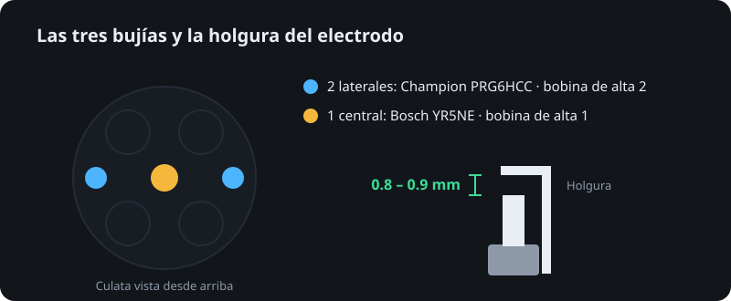

El motor lleva una bujía central, alimentada por la bobina de alta 1, y dos laterales (izquierda y derecha), alimentadas por la bobina de alta 2. La llave 3 en 1 permite sacar las tres con la culata montada en la moto.

## Desmontaje

1. Retira el capuchón de la bujía lateral izquierda y el de la bujía central, que queda en la parte de arriba de la culata.
2. En el lado derecho, retira la tapa que cubre la bujía y luego su capuchón.
3. Afloja y retira la bujía lateral izquierda con la llave 3 en 1.
4. Con la lateral izquierda ya afuera, retira la bujía central con la misma llave.
5. Retira la bujía lateral derecha.

## Revisión y montaje

1. Revisa en cada bujía el tipo, el color, la erosión del electrodo y si hay grietas o roturas.
2. Limpia cada bujía con un limpiador de bujías.
3. Mide la holgura del electrodo con un calibrador de alambre: debe estar entre 0.8 y 0.9 mm. Ajústala si hace falta.
4. Si toca cambiarlas, usa el tipo indicado para cada posición: no son iguales la central y las laterales.
5. Enrosca cada bujía a mano y termina de apretarla con la llave a 1.3 – 1.5 kgf·m.
6. Vuelve a montar los capuchones y la tapa del lado derecho, y comprueba que las tres bujías funcionen.

> El manual de la FI no describe el orden para sacar las bujías; los pasos de desmontaje son los del manual de la versión carburada, que usa la misma culata y la misma llave.

> Contradicciones del manual de la FI. Frecuencia: el cuadro de mantenimiento pide limpiar y ajustar en el 3.er y 5.º servicio (5000 y 10 000 km) y cambiar en el 7.º (15 000 km); el procedimiento de mantenimiento dice limpiar cada 2500 km y cambiar cada 10 000 km; y la página de puesta a punto dice cambiar cada 30 000 km. Tipo: el procedimiento de mantenimiento nombra Bosch YR5NE (central) y Champion PRG6HCC (laterales); la puesta a punto escribe «Bosch VR5NE» y «Champion RG6HCC». La holgura (0.8 – 0.9 mm) coincide en todas las páginas.
