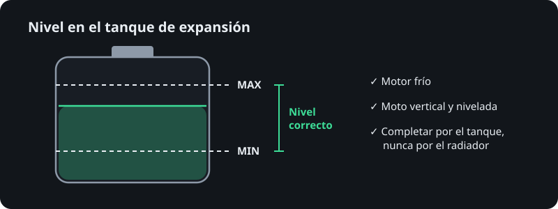

1. Espera a que el motor esté frío.
2. Deja la moto derecha, en un piso nivelado.
3. Mira el nivel en el tanque de expansión: debe estar entre las marcas MIN y MAX.

   
4. Si falta, quita la tapa del tanque de expansión y agrega refrigerante hasta la marca MAX. No completes por la tapa del radiador.
5. Coloca la tapa del tanque de expansión y comprueba que su manguera de ventilación quede bien dirigida.

> El cuadro de mantenimiento pide revisar y completar el nivel en cada servicio, y revisar las mangueras, las abrazaderas y las aletas del radiador desde el 2.º. Si el nivel baja seguido, busca fugas. Usa siempre refrigerante listo para usar de las marcas recomendadas; el manual de la FI no indica diluirlo.
