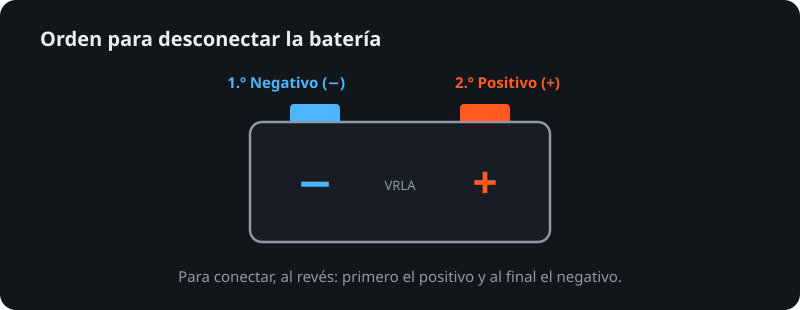

## Desconexión

1. Apaga el encendido, abre la cerradura del asiento con la llave y retira el asiento del pasajero.
2. Quita los 2 pernos del asiento del conductor y retíralo.
3. Quita los 2 pernos, con sus 2 bujes, que sujetan el soporte sobre la batería.
4. Desliza la ECU hacia afuera de la sujeción de la batería y apártala sin tensar su cableado.
5. Retira los capuchones de los dos terminales de la batería.
6. Afloja y desconecta el terminal negativo.

   
7. Desconecta el terminal positivo.
8. Levanta la batería y sácala.

## Instalación

1. Coloca la batería en su alojamiento.
2. Conecta primero el terminal positivo y al final el negativo.
3. Protege los bornes con vaselina y coloca los capuchones.
4. Desliza la ECU a su sitio en la sujeción de la batería y monta el soporte con sus 2 pernos y bujes.
5. Monta el asiento del conductor con sus 2 pernos y encaja el del pasajero.
6. Vuelve a poner la hora en el tablero.

> El manual de la FI escribe el orden al revés: «terminal positivo y luego el negativo». Con el negativo todavía conectado, cualquier contacto de la llave entre el borne positivo y el chasis es un cortocircuito directo; por eso esta guía sigue el orden del manual de la carburada, que usa la misma batería: primero el negativo al desconectar y primero el positivo al conectar.

> El manual no da las medidas de las llaves ni el torque de los bornes. Para protegerlos pide vaselina y prohíbe la grasa.
