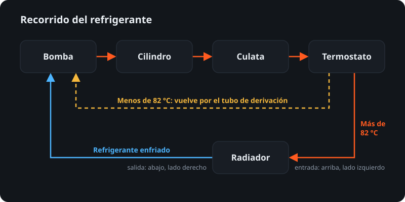

## Qué controla la ECU

En la versión FI no hay CDI: la unidad de control electrónico (ECU) lee el sensor de temperatura del refrigerante y con ese dato corrige la inyección y el encendido, enciende el ventilador del radiador a los 98 °C por medio de su relé y hace que el tablero avise cuando el motor pasa de 115 °C. Si falla el sensor, el relé o el ventilador, la ECU guarda un código y enciende el testigo de falla: consulta la guía «Leer los códigos de falla».

## Cómo circula el refrigerante

La bomba impulsa el refrigerante por los conductos del cilindro y de la culata hasta el termostato. Con el motor frío el termostato lo devuelve a la bomba por el tubo de derivación para que el motor caliente rápido. Al alcanzar su temperatura de apertura, lo envía a la parte superior izquierda del radiador; sale enfriado por la parte inferior derecha y vuelve a la bomba.

> El diagrama y esta descripción vienen del manual de la versión carburada. Ese manual indica que el termostato empieza a abrir a los 82 °C (88 ± 2 °C según otra de sus páginas), que queda abierto del todo a los 96 °C y que la válvula de la tapa del radiador abre a 1.4 kg/cm². El manual de la FI no da esos valores.

## Para evitar que se mezclen aceite y refrigerante

- Reemplaza siempre la junta de culata y la junta del cilindro por nuevas al abrir el motor.
- Reemplaza la junta de los cárteres y los retenes de la bomba de refrigerante cada vez que separes los cárteres.
- No reutilices O-rings: el de la cubierta de la bomba de refrigerante se cambia al desmontarla.

## Mangueras y aletas

- El cuadro de mantenimiento de la FI pide revisar las mangueras, sus abrazaderas y posibles fugas, y las aletas del radiador, en cada servicio desde el 2.º.
- El nivel se revisa y completa en cada servicio con refrigerante listo para usar.
