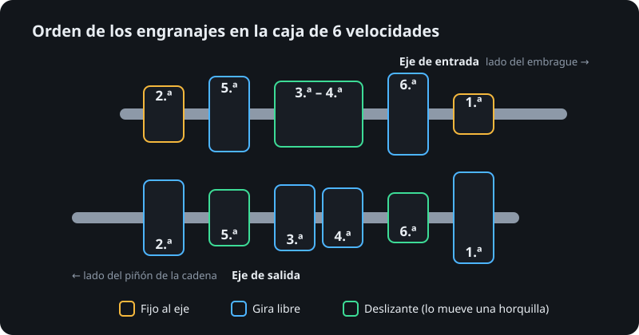

El manual desarma el motor en este orden: primero la culata, el cilindro y el pistón; después la tapa del embrague y el embrague; y por último lo que cubre esta guía. Empieza por las guías «Desmontar la culata, el cilindro y el pistón» y «Desmontar y revisar el embrague». El manual de la FI no describe cómo bajar el motor del chasis.

## Mecanismo de cambios

1. Retira el eje de la palanca de cambios.
2. Quita el perno del tope del tambor y retira la arandela de diámetro grande, el brazo de tope (inhibidor), la arandela de diámetro pequeño y el resorte.
3. Quita el perno Allen de la estrella de cambios y retira la estrella y su espaciador. Recupera el pin de la estrella.

## Bomba de aceite

1. Quita el anillo de retención y retira el piñón conductor de la bomba de aceite.
2. Quita los 3 pernos con reborde M6 × 30 (cabeza de 8 mm) y retira el cuerpo de la bomba con sus 2 pasadores guía.
3. Retira el rotor interior y el rotor exterior.

## Tapa del magneto y volante

1. Quita los pernos M6 × 30 de la tapa del magneto (cabeza de 8 mm), aflojándolos en cruz, y retira la tapa.
2. Sujeta el volante con el sujetador especial y quita su perno hexagonal con reborde (14 mm) y la arandela Belleville.
3. Saca el volante con el extractor y recupera su chaveta.
4. Quita el perno de pivote y retira la guía de la cadenilla (lado flojo) y la cadenilla.
5. Retira los engranajes intermedios 1 y 2 del arranque.

## Interruptor de neutro, sensor y estator

1. Quita los 2 pernos M5 × 10 y el gancho superior del ramal.
2. Quita el perno M5 × 10 y el gancho inferior del ramal.
3. Quita los 2 pernos M5 × 16 y retira el interruptor de neutro con cuidado: lleva un pin y un resorte.
4. Quita los 2 pernos M5 × 13 y retira el captador, que el manual llama «bobina de salida»: es el sensor del ángulo del cigüeñal.
5. Quita el perno M5 × 6 y la placa tope del cableado.
6. Quita los 3 pernos Allen del estator (llave de 4 mm) y retíralo.

## Balanceador

1. Bloquea los engranajes con el sujetador especial y quita la tuerca de seguridad del engranaje conductor del balanceador.
2. Retira la arandela Belleville, el engranaje conductor y su chaveta.
3. Quita el perno Allen del engranaje conducido y retira la arandela especial, el engranaje y su chaveta cuadrada.

## Bomba de refrigerante

1. Quita los 5 pernos M6 × 20 (cabeza de 8 mm) y retira la cubierta de la bomba con su O-ring.
2. Quita la tuerca ciega y la arandela.
3. Retira el rotor de la bomba. No hagas palanca con un objeto puntiagudo entre el rotor y el cárter: da un golpe suave al eje del balanceador para soltarlo.

## Separación de los cárteres

1. Quita los 4 pernos largos M6 × 60 (cabeza de 8 mm).
2. Quita los 10 pernos cortos M6 × 45 del lado del magneto.
3. Retira el tope del rodamiento del eje de entrada, del lado del embrague: en ese lugar apoya el separador.
4. Separa los cárteres con la herramienta especial.
5. Retira el cárter derecho, la junta y los 2 pasadores guía (diámetro 14).
6. Retira el cigüeñal.

## Caja de cambios

1. Retira los ejes de las horquillas de entrada y de salida con sus 2 resortes.
2. Retira el tambor selector.
3. Retira las horquillas de cambio de entrada y de salida.
4. Retira el eje de entrada y el eje de salida. No pierdas la arandela del engranaje de 1.ª del eje de salida ni la que va bajo el engranaje de 2.ª del eje de entrada.

> El manual de la FI no trae el despiece de los ejes. El esquema muestra el orden del manual de la versión carburada, que usa la misma caja de 6 velocidades con la misma reducción primaria (3.272); márcalo todo al sacarlo y móntalo en el mismo lugar.

## Consejos para el armado

- Calienta el cárter del lado del embrague para que el rodamiento del cigüeñal entre suave.
- Comprueba que los conductos de aceite y el orificio calibrado estén libres.
- Alinea las marcas de los engranajes conductor y conducido del balanceador con el pistón en punto muerto superior y la marca del piñón primario alineada con la del cárter. El collar de los dos engranajes mira hacia el cárter.
- Coloca los espaciadores de los pernos Allen con la cara plana hacia afuera.
- No olvides el espaciador al montar la estrella de cambios.
- Tapa la abertura del cárter del lado del magneto con un paño sin pelusa al fijar la guía del ramal, para que no caiga un perno adentro.
- Tras reparar el motor, la carga de aceite es de 1400 ml.

> Contradicción del manual: el desarme general dice que la tapa del magneto lleva 9 pernos M6 × 30 y el procedimiento del sensor del cigüeñal dice 13 pernos.
