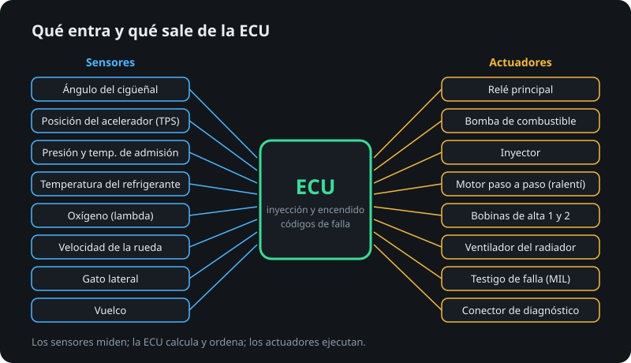

En la versión FI no hay carburador ni CDI. Una sola unidad, la ECU, recibe las señales de los sensores, las convierte a valores digitales y con ellas decide cuánto combustible inyectar y en qué momento saltar la chispa. También guarda los códigos de falla que se leen con el testigo del tablero o con la herramienta de diagnóstico.

## Recorrido del combustible

La bomba toma el combustible del tanque a través de su colador y lo envía presurizado al filtro de combustible, y de ahí al inyector. Al final del circuito, el regulador de presión mantiene constante la diferencia de presión en el inyector y devuelve el sobrante al tanque; ese retorno mantiene fresco el combustible y evita que se formen burbujas de vapor. El inyector trabaja con una presión cercana a 2.5 bar.

## Dónde están las piezas

- **En el cuerpo de aceleración y la admisión:** inyector, motor paso a paso, TPS y TMAP.
- **En el motor:** sensor del ángulo del cigüeñal (lado del magneto), sensor de temperatura del refrigerante, sensor de presión de aceite y sensor de oxígeno en el escape.
- **En el tanque:** bomba de combustible y sensor de nivel, cada uno con su conector.
- **Detrás de la caja del filtro de aire, sobre el chasis:** sensor de vuelco.
- **En el mismo grupo que la caja de fusibles:** relés auxiliares de arranque 1, 2 y 3 e interfaz CAN.

## Modo limitado

Si falla un sensor o su cableado, la ECU puede usar un valor de reemplazo y encender el testigo de falla. En ese modo el motor funciona con encendido y mezcla fijos: alcanza para llegar al taller, con mucho menos rendimiento.

> El manual da dos valores para el ángulo en que el sensor de vuelco corta el encendido: más de 68° en la lista de componentes y 60° hacia cualquier lado en la explicación de su funcionamiento. No da valores de resistencia ni de voltaje para probar los sensores en este capítulo; las revisiones eléctricas están en el capítulo del sistema eléctrico del manual.
