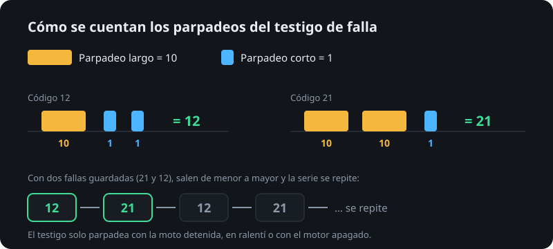

Cuando la ECU detecta una falla en un sensor, un actuador o su cableado, guarda un código y enciende el testigo de falla del tablero (MIL). Si el que falla es un solo sensor, la ECU puede reemplazar su lectura por un valor fijo para que el motor siga funcionando. El código se lee de dos maneras: contando los parpadeos del testigo o conectando la herramienta de diagnóstico, que muestra el código P completo.

## Contar los parpadeos

1. Deja la moto detenida, con el motor en ralentí o apagado: el testigo solo parpadea en esas condiciones. En marcha queda encendido fijo.
2. Observa el testigo de falla y cuenta los parpadeos largos: cada uno vale 10.
3. Cuenta los parpadeos cortos que siguen: cada uno vale 1.
4. Suma los dos grupos. Por ejemplo, un largo y dos cortos dan el código 12.
5. Si hay varias fallas guardadas, anótalas todas: la ECU las muestra una tras otra, empezando por el número más bajo, y después repite la serie. Con las fallas 21 y 12 guardadas, verás 12, 21, 12, 21 y así sucesivamente.
6. Busca cada número en la columna «Parpadeo» de la tabla. Un mismo número de parpadeo agrupa varios códigos P del mismo componente; para saber cuál es exactamente hace falta la herramienta de diagnóstico.

## Después de reparar

1. Corrige la causa: revisa primero el conector y el cableado del componente señalado, que deben estar limpios, firmes y sin cables quemados.
2. Usa la moto con normalidad. Según el manual, hacen falta 3 ciclos de conducción para que se borren todos los códigos.

> El manual dice que la serie de parpadeos se repite «hasta que se abra el terminal de autodiagnóstico», pero no explica dónde está ese terminal ni cómo se usa. La herramienta de diagnóstico se conecta por la interfaz CAN, que el manual ubica en el mismo grupo que la caja de fusibles y los relés auxiliares de arranque; no da el código de parte de la herramienta.
