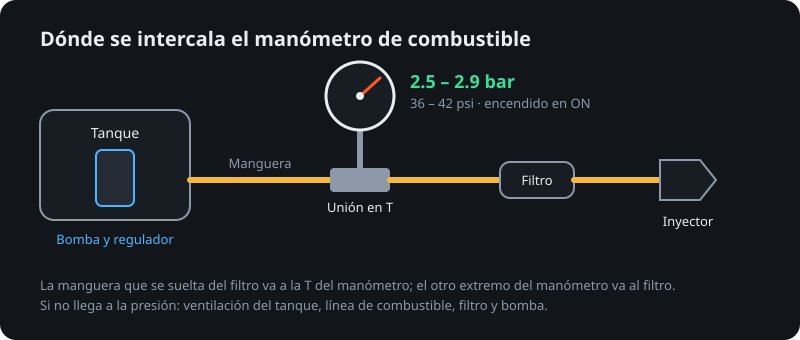

## Conexión

1. Retira los asientos, las tapas laterales y la cubierta del tanque, y suelta los pernos del tanque siguiendo su guía, sin desconectar la bomba.
2. Levanta el tanque y suelta la manguera de combustible del lado del filtro.
3. Conecta esa manguera a la unión en T del manómetro.
4. Conecta el otro extremo del manómetro al filtro de combustible.
5. Vuelve a apoyar el tanque en su lugar.

## Lectura

1. Pon el interruptor de encendido en ON.
2. Lee la presión en el manómetro: debe estar entre 2.5 y 2.9 bar (36 a 42 psi).
3. Pon el encendido en OFF, retira el manómetro con un paño alrededor de las uniones y conecta la manguera al filtro con su clip.

## Si la presión no llega

1. Revisa que la ventilación del tanque no esté obstruida.
2. Revisa que la línea de combustible no esté doblada ni tapada.
3. Revisa el filtro de combustible.
4. Comprueba la bomba con la guía «Probar la entrega de la bomba de combustible».

> El regulador de presión está en el módulo de la bomba, dentro del tanque, y devuelve al tanque el combustible sobrante. El manual no da código de parte para el manómetro de combustible ni un procedimiento para probar el regulador por separado.
