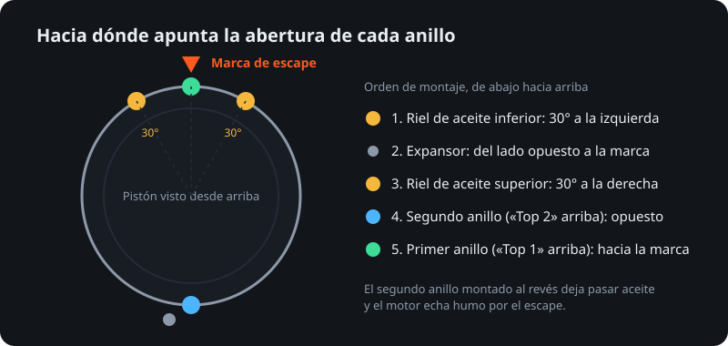

## Tapa de culata y punto muerto superior

1. Quita los 4 pernos de la tapa de culata (cabeza de 10 mm), aflojándolos en cruz, y retira la tapa con su junta de goma moldeada.
2. Lleva el motor al punto muerto superior: alinea la marca del volante con la referencia del cárter izquierdo y comprueba, mirando desde el lado derecho, las marcas del piñón del árbol de levas.
3. Antes de seguir, anota la holgura de válvulas (0.05 mm en admisión y 0.08 mm en escape) y el estado de la sincronización.

## Tensor y piñón del árbol de levas

1. En el tensor de la cadenilla, quita el perno central (10 mm) con su O-ring.
2. Gira el tornillo interno del tensor en sentido horario para recoger el émbolo y dejarlo trabado.
3. Quita los 2 pernos M6 de fijación (cabeza de 8 mm) y retira el tensor y su junta.
4. Sostén el piñón con la herramienta especial 37 1042 54 y quita el perno especial con reborde (12 mm).
5. Retira el piñón y el espaciador del árbol de levas. Ata la cadenilla con un alambre blando de cobre para que no caiga dentro del motor.

## Culata y válvulas

1. Afloja primero los pernos cortos de la culata y después los 4 pernos largos, en cruz. Retira la culata.
2. Comprime cada resorte con el compresor y su adaptador, y retira las cuñas.
3. Retira los 4 platillos retenedores, los 4 resortes, los 4 retenes de válvula y los asientos de los resortes.
4. Saca las 2 válvulas de admisión y las 2 de escape. Guárdalas ordenadas para devolver cada una a su lugar.

## Cilindro y pistón

1. Retira la junta de culata, la guía de la cadenilla y los 2 pasadores guía.
2. Levanta el cilindro y retira su junta y los 2 pasadores guía.
3. Tapa la boca del cárter con un paño limpio que no suelte pelusa.
4. Quita el anillo de retención del pasador, empuja el pasador con el botador y retira el pistón.

## Anillos del pistón

Los anillos se orientan tomando como referencia la marca de escape de la cabeza del pistón.

1. En la ranura inferior, coloca primero el riel de aceite de abajo, con la abertura 30° a la izquierda de la marca de escape.
2. Coloca el expansor con la abertura del lado opuesto a la marca.
3. Coloca el riel de aceite de arriba sobre el expansor, con la abertura 30° a la derecha de la marca.
4. Coloca el segundo anillo con la inscripción «Top 2» hacia arriba y la abertura del lado opuesto a la marca.
5. Coloca el primer anillo con la inscripción «Top 1» hacia arriba y la abertura hacia la marca de escape.

## Revisión y armado

1. Mide las piezas y compáralas con la tabla. Reemplaza lo que supere el límite de servicio.
2. Arma en orden inverso con juntas, O-rings y seguros nuevos.
3. Aprieta los pernos grandes de la culata en cruz a 4.4 – 4.6 kgf·m y los pequeños a 1.0 – 1.2 kgf·m.
4. Monta el piñón del árbol de levas con las marcas paralelas a la superficie de la culata y aprieta su perno a 2.5 kgf·m.
5. Monta el tensor (pernos a 1.0 – 1.2 kgf·m) y la tapa de culata (1.0 – 1.2 kgf·m, en cruz).
6. Ajusta la holgura de válvulas siguiendo su guía. Al montar las bujías, enróscalas a mano y luego dales el torque.

> El manual de la FI no muestra el desmontaje del árbol de levas ni de los balancines, aunque lista sus extractores (37 10DH 35 para los ejes de balancines y 37 10DH 31 para el rodamiento pequeño del árbol de levas), y no indica cuántos pernos cortos lleva la culata. Cita algunas herramientas con dos códigos distintos: el compresor con adaptador aparece como 37 1031 08 en el procedimiento, y el botador del pasador como 37 10DS 27 en la lista de herramientas y 37 1010 06 en el procedimiento.

> Para el pistón, el manual da el diámetro del «grupo A» (71.964 – 71.976 mm) y deja en blanco el «grupo B».
