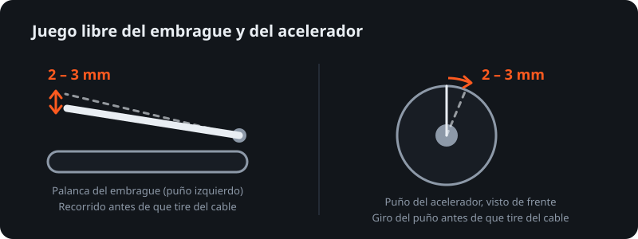

## En el manubrio

1. Corre el protector de goma que cubre la base de la palanca.
2. Comprueba que el cable del embrague esté bien asentado en el tensor.
3. Gira el tensor hasta dejar 2 a 3 mm de juego libre en la palanca.
4. Aprieta la tuerca del tensor y vuelve a colocar el protector.

## En la tapa del embrague

Usa este ajuste solo si el tensor del manubrio no alcanza.

1. Ubica el tensor del extremo inferior del cable, sujeto al soporte de la tapa del embrague.
2. Afloja las dos tuercas de 12 mm que fijan el cable al soporte.
3. Desplaza el cable en el soporte, enroscando una tuerca y desenroscando la otra, hasta obtener 2 a 3 mm de juego en la palanca.
4. Aprieta las dos tuercas una contra la otra, sosteniendo una y girando la otra.
5. Comprueba de nuevo el juego en la palanca.
