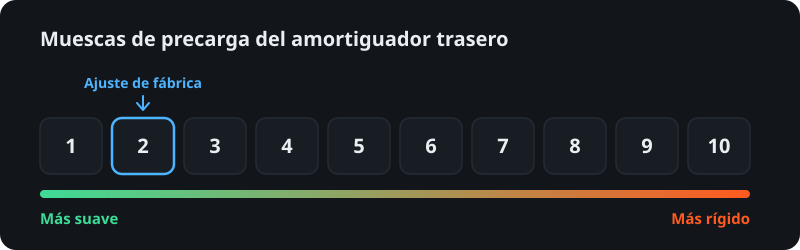

1. Ubica el regulador de leva en la base del resorte del amortiguador trasero.
2. Encaja la llave de ajuste en el regulador y gíralo hasta la muesca deseada. Una muesca más alta endurece el resorte; una más baja lo ablanda.

   
3. Prueba la moto y corrige si hace falta.

> Un ajuste demasiado blando o demasiado rígido empeora el confort y la estabilidad. Para uso normal, parte del ajuste de fábrica (muesca 2) y sube si llevas pasajero o carga.

> Ningún manual indica qué muesca corresponde a cada peso. El de la carburada da la escala de 10 muescas, de suave a rígido, y el ajuste de fábrica; el de la FI confirma la muesca 2 como ajuste estándar y cataloga la llave con otro número de herramienta.
