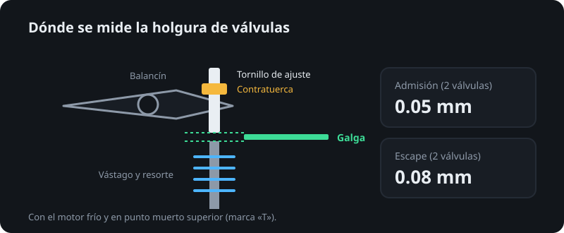

## Acceso

1. Retira el tanque de combustible y el elemento del filtro de aire siguiendo sus guías.
2. Aparta hacia un lado el cable del acelerador y lo que estorbe sobre la tapa.
3. Quita los 4 pernos de la tapa de culata, aflojándolos en cruz, y retira la tapa.

## Punto muerto superior

1. Quita el tornillo que sujeta la tapa de inspección del lado del magneto y retira la tapa.
2. Gira el motor con el perno del piñón del árbol de levas hasta que las dos marcas del piñón queden paralelas al borde de la culata y la marca «T» quede arriba.
3. Comprueba en la ventana del cárter que la marca «T» del volante esté alineada con la marca de referencia.
4. Comprueba que el pistón esté al final de la carrera de compresión: los dos balancines deben quedar libres.

## Medición y ajuste

1. Mide la holgura de cada válvula con la galga entre el tornillo de ajuste del balancín y el vástago.
2. Si no coincide, afloja la contratuerca, gira el tornillo de ajuste hasta dejar 0.05 mm en las dos válvulas de admisión y 0.08 mm en las dos de escape, y aprieta la contratuerca.
3. Vuelve a medir después de apretar: la holgura suele cambiar al fijar la contratuerca.
4. Gira el cigüeñal, vuelve al punto muerto superior de compresión y repite la medición. Si cambió, ajusta otra vez.

## Cierre

1. Monta la tapa de culata con su junta y aprieta los pernos en cruz a 1.0 – 1.2 kgf·m.
2. Coloca la tapa de inspección del magneto.
3. Devuelve el cable del acelerador a su lugar y monta el filtro de aire y el tanque.

> Los dos manuales dan un solo valor por válvula (0.05 y 0.08 mm), sin rango ni límite de servicio, y ninguno indica torque para la contratuerca del tornillo de ajuste. Los pasos de acceso y la tapa de inspección vienen del manual de la versión carburada; el de la FI confirma las holguras, la posición de las marcas, la comprobación tras girar el cigüeñal y el torque de la tapa, y lista una herramienta especial para el ajuste (sujetador de taqué F4 1ZJW 33 / 37 1031 53).
