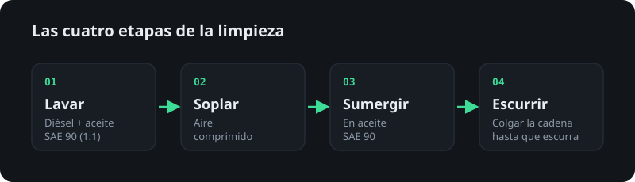

1. Desmonta la cadena de la moto.
2. Límpiala en una mezcla de diésel y aceite SAE 90 en partes iguales (1:1).
3. Sopla la cadena con aire comprimido a baja presión para sacar la suciedad y el exceso de mezcla.
4. Sumerge la cadena en aceite SAE 90.
5. Cuélgala y deja que escurra el exceso de aceite.
6. Monta la cadena usando siempre un seguro (pin de bloqueo) nuevo y comprueba que la junta quede bien asentada.
7. Ajusta la holgura de la cadena.

> Cada cuánto: el cuadro de mantenimiento de la versión carburada pide desmontar, revisar y lubricar la cadena en cada servicio a partir del segundo (cada 5000 km) y cambiar el seguro cada vez que se abre; el de la versión FI pide limpiarla, lubricarla y ajustarla en todos los servicios (cada 2500 km). En las dos, la cadena se lubrica con aerosol cada 500 km entre servicios.

> El manual de la FI describe esta limpieza para la cadena con O-rings, pero su matriz de lubricación anota el aceite SAE 90 como producto para «cadena sin juntas tóricas». Las cuatro etapas son las mismas en los dos manuales.
