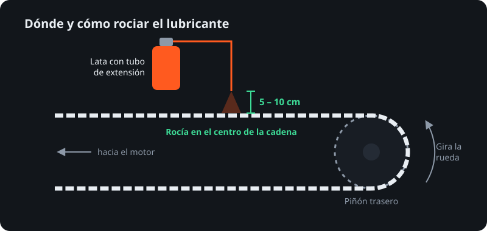

1. Apoya la moto sobre el caballete central o un soporte de taller para que la rueda trasera gire libre.
2. Quita el polvo de la cadena con un paño limpio.
3. Agita la lata con la válvula hacia abajo hasta oír la bolilla interna y coloca el tubo de extensión.
4. Sostén la lata junto al piñón trasero, alineada con la cadena, con la punta del tubo a 5–10 cm.

   
5. Gira la rueda hacia atrás y rocía el lubricante en el centro de la cadena: así se reparte hacia los eslabones y los piñones.
6. Sigue rociando hasta dar una vuelta completa de cadena.
7. Gira la rueda 3 o 4 vueltas más para que el lubricante termine de penetrar.
8. Limpia cualquier exceso que haya caído en la llanta o el rin.
