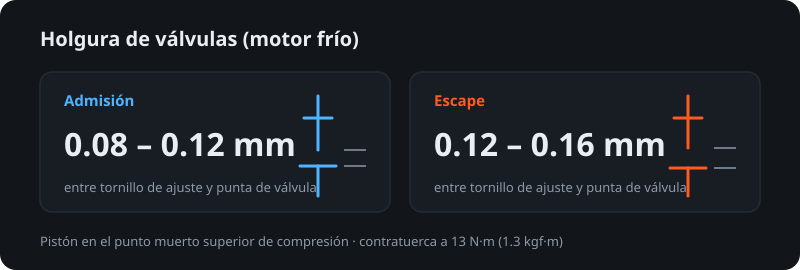

## Acceso

1. Quita el asiento, las cubiertas laterales y el tanque de combustible.
2. Desconecta la manguera del sistema de inducción de aire de la cubierta de culata.
3. Quita la cubierta de culata y su junta.
4. En la cubierta izquierda del motor, quita el tapón de la marca de tiempo y el tapón del extremo del cigüeñal.

## Medición

1. Gira el cigüeñal en sentido antihorario hasta que el pistón llegue al punto muerto superior de compresión: la marca del rotor del magneto queda alineada con la referencia fija de la cubierta.
2. Comprueba que los lóbulos del árbol de levas no estén presionando los balancines. En esta posición las dos válvulas deben tener algo de holgura.
3. Mide la holgura de cada válvula con las galgas, entre el tornillo de ajuste y la punta de la válvula.
4. Compara con la especificación: admisión 0.08 – 0.12 mm, escape 0.12 – 0.16 mm.

## Ajuste

1. Afloja la contratuerca del tornillo de ajuste.
2. Coloca la galga del valor correcto entre el tornillo y la punta de la válvula.
3. Gira el tornillo de ajuste hasta que la galga deslice con un roce leve.
4. Sujeta el tornillo para que no gire y aprieta la contratuerca a 13 N·m (1.3 kgf·m).
5. Vuelve a medir. Si quedó fuera de rango, repite el ajuste.

## Cierre

1. Coloca los dos tapones de la cubierta izquierda con O-rings nuevos.
2. Monta la cubierta de culata con junta nueva.
3. Conecta la manguera del sistema de inducción de aire.
4. Monta el tanque, las cubiertas laterales y el asiento.
