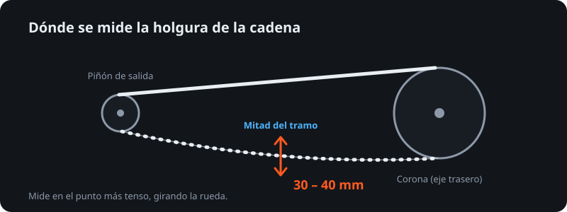

## Medición

1. Apoya la moto sobre el caballete central, en una superficie plana, con la rueda trasera en el aire.
2. Gira la rueda trasera y busca el punto en que la cadena queda más tensa. La holgura se mide ahí.
3. Mide el movimiento vertical de la cadena a mitad del tramo entre el piñón de salida y el eje de la rueda trasera. Debe estar entre 30 y 40 mm. Si no, ajústala.

## Ajuste

1. Afloja la tuerca de la varilla del freno trasero.
2. Afloja la tuerca del eje de la rueda trasera.
3. Gira las tuercas de ajuste de los tensores, la misma cantidad en ambos lados, hasta dejar la holgura dentro del rango.
4. Comprueba la alineación: las marcas de referencia del basculante deben quedar en la misma posición respecto a la arandela del tensor en los dos lados.
5. Aprieta las contratuercas de los tensores y luego la tuerca del eje a 90 N·m (9.0 kgf·m).
6. Ajusta el juego libre del pedal del freno trasero (15 a 20 mm), porque cambia al mover la rueda.

> El manual indica 90 N·m para la tuerca del eje trasero, pero en la página del montaje de la rueda trasera lo acompaña de una equivalencia distinta (8.0 kgf·m). La tabla general de torques y el procedimiento de ajuste coinciden en 90 N·m (9.0 kgf·m).
