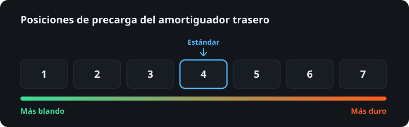

1. Apoya la moto de forma estable.
2. Ubica el anillo de ajuste de precarga en el amortiguador trasero.
3. Con la llave de ajuste, gira el anillo hasta alinear la posición deseada con el tope. Más precarga endurece la suspensión; menos precarga la ablanda.

   

4. Prueba la moto y corrige si hace falta.

> Parte de la posición estándar (4) y sube si llevas pasajero o carga.
